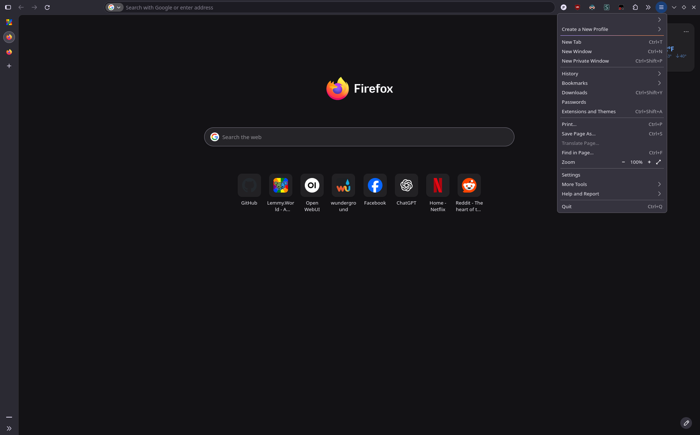
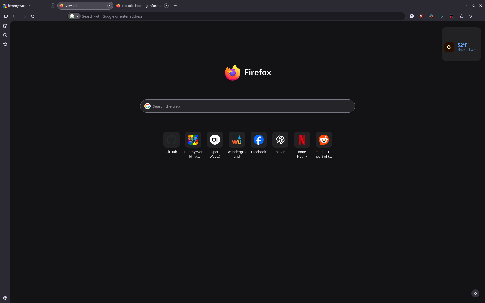

# Firefox 157 Nova — Flat Dark Theme

A custom `userChrome.css` and `userContent.css` theme for Firefox 157's Nova UI.

The goal is to keep Nova enabled while making the interface flatter, more compact, and closer to a traditional desktop Firefox UI, without losing Nova's newer features. It supports both vertical and horizontal tabs.

Built and tested using Firefox's Browser Toolbox, with ChatGPT assisting in generating, debugging, and refining the CSS.

## Screenshots

### Vertical tabs — compact sidebar and application menu



### Expanded vertical tabs and bookmarks sidebar


### Horizontal tabs



### Focused URL bar and internal page styling


## Changes

### General Appearance

- Removes Nova's purple/orange toolbar and sidebar gradients
- Replaces most purple UI accents with Firefox-style blue
- Uses consistent flat dark backgrounds throughout the browser chrome
- Uses a slightly lighter popup/menu background so dark favicons are easier to see
- Reduces excessive menu and panel corner rounding
- Makes menus and panels more compact
- Includes separate inactive-window colors

### URL Bar

- Removes unwanted background gradients
- Uses a consistent dark URL field background
- Changes URL suggestion links and type indicators to blue
- Reduces the rounding of the autocomplete dropdown to 8px
- Adds a subtle border around the autocomplete dropdown to match other panels

### Tabs and Sidebar

- Supports both vertical and horizontal tab layouts
- Flattens Nova's redesigned sidebar
- Uses consistent sidebar and vertical-tab backgrounds
- Gives the selected tab a subtle background; refines tab hover highlighting
- Slightly reduces the vertical-tab close button size
- Uses neutral gray close-button outlines

### Bookmarks

- Restyles the bookmark editor with a more compact layout
- Reduces unnecessary horizontal padding
- Changes bookmark editor buttons, outlines, expanders, and checkbox accents to blue
- Restyles the expanded folder and tag selection areas
- Changes the bookmarked-page star to blue

### Downloads

- Changes the completed-download indicator from purple to blue

### Internal Pages (`userContent.css`)

- Replaces lavender accents with blue on supported Firefox internal pages
- Uses neutral gray buttons and borders, including hover and active styling on `about:support`
- Restyles table headers and links on internal pages
- Makes the New Tab **Customize** button gray with light text and rounded corners

### Extension Popup Compatibility

Firefox extension popups can be styled at two different levels: the outer popup container managed by Firefox and the HTML content rendered by the extension itself.

- **`userChrome.css`** controls Firefox's outer popup containers. The theme applies custom panel rounding and padding to most Firefox menus and panels, but excludes Dark Reader to prevent an unwanted outer frame.
- **`userContent.css`** controls the HTML inside extension popups. An included example removes an unwanted border from a translation extension's popup.
- Both rules can serve as examples for customizing other extensions. The appropriate approach depends on whether the element you want to change belongs to Firefox's interface or the extension's HTML.

The Dark Reader exception works automatically through `userChrome.css`. The optional `userContent.css` example targets a specific `moz-extension://` UUID, which may differ between Firefox installations. To adapt it for another extension, identify its URL using Firefox's Browser Toolbox and update the rule accordingly.

## Customizing Colors

Most browser-chrome colors are centralized in the `:root` section near the top of `userChrome.css`. For example:

```css
:root {
    --my-window-bg: #1c1b22;
    --my-toolbar-bg: #2b2a33;
    --my-sidebar-bg: #2b2a33;

    --my-tab-selected: #484752;
    --my-tab-hover: rgba(255, 255, 255, 0.08);

    --my-border: #42414d;
    --my-text: #fbfbfe;

    --my-button-hover: rgba(0, 97, 224, 0.25);
    --my-button-active: rgba(0, 97, 224, 0.40);
    --my-button-selected: #0061e0;
}
```

Change these variables to customize much of the browser-chrome palette. Some colors and corner radii are defined directly in individual rules.

`userContent.css` has its own `:root` variables for internal pages, including the newer Nova `--color-accent-primary` and `--button-background-color-primary` variables. The New Tab Customize button has a separate gray override.

## Installation

1. Open Firefox and navigate to `about:config`.
2. Set `toolkit.legacyUserProfileCustomizations.stylesheets` to `true`.
3. Navigate to `about:support`.
4. Find **Profile Directory** and click **Open Directory**.
5. Create a folder named `chrome` inside your Firefox profile if one doesn't already exist.
6. Copy `userChrome.css` and `userContent.css` into that folder.
7. Restart Firefox.

Your directory should look like:

```text
<Firefox profile>/
└── chrome/
    ├── userChrome.css
    └── userContent.css
```

**Note:** `userChrome.css` modifies Firefox's interface, while `userContent.css` styles supported internal pages and the included extension-specific popup example. You can use `userChrome.css` on its own, but the internal-page and New Tab button changes require `userContent.css`.

## Compatibility

Developed and tested with:

- Firefox 157
- Nova UI enabled
- Dark theme
- Vertical and horizontal tabs
- Dark Reader extension

The theme is designed around Firefox 157's interface. It has not been comprehensively tested with other Firefox versions, themes, or extension combinations.

Some selectors, internal variables, and popup structures may change in future Firefox releases.

## Notes

This theme does not disable Nova or restore the old Firefox interface. It restyles the current Nova interface using Firefox's custom stylesheet support.

The CSS uses Firefox-specific selectors and internal UI variables, so future updates may require adjustments.

Extension popups can use different Firefox containers and their own internal styles. The Dark Reader exception is included to avoid a popup layout issue encountered during development.

The screenshots above are referenced by their current filenames. Add the four PNG files to the same repository directory as `README.md` for GitHub to display them.

