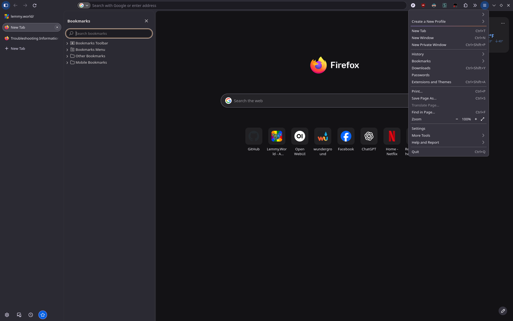
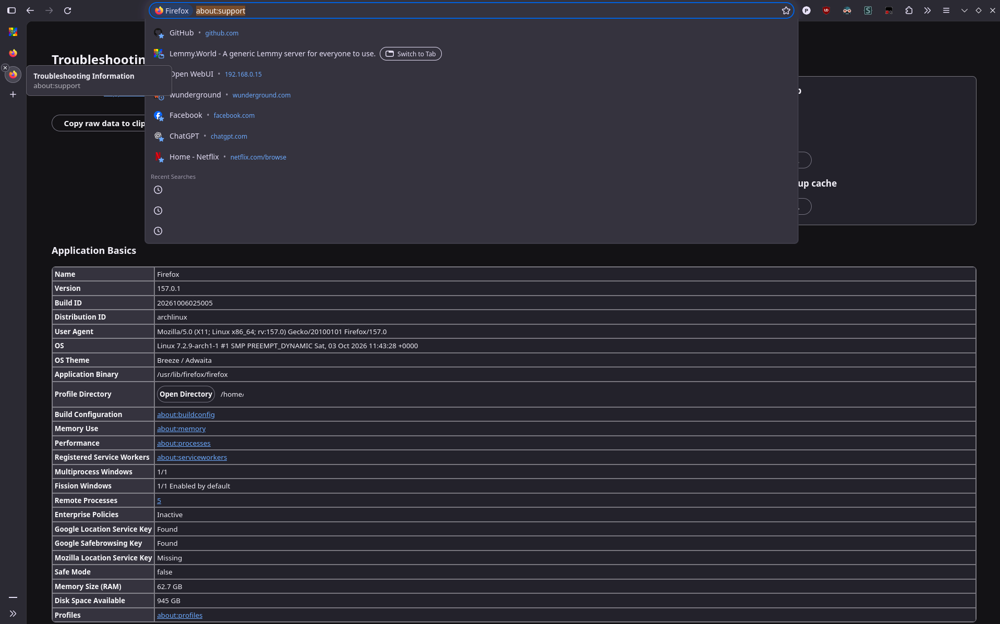

# Firefox 157 Nova — Flat Dark Theme

A custom `userChrome.css` and `userContent.css` theme for Firefox 157's Nova UI.

The goal is to keep Nova enabled while making the interface flatter, more compact, and closer to a traditional desktop Firefox UI, without losing Nova's newer features. It supports both vertical and horizontal tabs.

Built and tested using Firefox's Browser Toolbox, with ChatGPT assisting in generating, debugging, and refining the CSS.

## Screenshots

### Vertical tabs — compact sidebar and application menu


### Expanded vertical tabs and bookmarks sidebar



### Horizontal tabs


### Focused URL bar and internal page styling



## Changes

### General Appearance

- Removes Nova's purple/orange toolbar and sidebar gradients
- Replaces most purple UI accents with Firefox-style blue
- Uses consistent flat dark backgrounds throughout the browser chrome
- Uses a slightly lighter popup/menu background so dark favicons are easier to see
- Reduces excessive menu and panel corner rounding
- Makes menus and panels more compact
- Includes separate inactive-window colors
- Refines button hover, active, selected, and focus colors

### URL Bar

- Removes unwanted background gradients
- Uses a consistent dark URL field background
- Changes URL suggestion links and type indicators to blue
- Reduces the rounding of the autocomplete dropdown to 8px
- Adds a subtle border around the autocomplete dropdown to match other panels

### Tabs and Sidebar

- Supports both vertical and horizontal tab layouts
- Flattens Nova's redesigned sidebar
- Uses consistent sidebar and vertical-tab backgrounds
- Gives the selected tab a subtle background; refines tab hover highlighting
- Slightly reduces the vertical-tab close button size
- Uses neutral gray close-button outlines

### Bookmarks

- Restyles the bookmark editor with a more compact layout
- Reduces unnecessary horizontal padding
- Changes bookmark editor buttons, outlines, expanders, and checkbox accents to blue
- Restyles the expanded folder and tag selection areas
- Changes the bookmarked-page star to blue

### Downloads

- Changes the completed-download indicator from purple to blue

### Browser Popups and Permissions

- Maintains compact Firefox menus and panels while allowing individual popups to use appropriate spacing
- Adjusts location permission prompt padding to provide more consistent spacing around its content
- Adds horizontal padding to Firefox's built-in page translation popup without introducing unnecessary vertical padding
- Preserves compact bookmark menus while independently styling other browser panels

The built-in translation popup is styled through `userChrome.css`, since it belongs to Firefox's browser interface rather than webpage content.

### Back/Forward Swipe Navigation

- Replaces the purple accent used by Firefox's touchpad swipe navigation indicators with blue
- Uses Firefox's internal swipe indicator color variable rather than overriding individual SVG shapes
- Preserves the existing back/forward gesture animations and navigation behavior

The swipe indicators are dynamically created by Firefox during horizontal touchpad gestures. Their styling is controlled through `userChrome.css`.

### Internal Pages (`userContent.css`)

- Replaces lavender accents with blue on supported Firefox internal pages
- Uses neutral gray buttons and borders, including hover and active styling on `about:support`
- Overrides Nova's purple/lavender button active-state colors where applicable
- Restyles table headers and links on internal pages
- Makes the New Tab **Customize** button gray with light text and rounded corners

### Extension Popup Compatibility

Firefox extension popups can be styled at two different levels: the outer popup container managed by Firefox and the HTML content rendered by the extension itself.

- **`userChrome.css`** controls Firefox's outer popup containers. The theme applies custom panel rounding and padding to most Firefox menus and panels, but excludes Dark Reader to prevent an unwanted outer frame.
- **`userContent.css`** controls the HTML inside extension popups. An included example removes an unwanted border from a translation extension's popup.
- Both rules can serve as examples for customizing other extensions. The appropriate approach depends on whether the element you want to change belongs to Firefox's interface or the extension's HTML.

The Dark Reader exception works automatically through `userChrome.css`. The optional `userContent.css` example targets a specific `moz-extension://` UUID, which may differ between Firefox installations. To adapt it for another extension, identify its URL using Firefox's Browser Toolbox and update the rule accordingly.

## Customizing Colors

Most browser-chrome colors are centralized in the `:root` section near the top of `src/userChrome.css`. For example:

```css
:root {
    --my-window-bg: #1c1b22;
    --my-toolbar-bg: #2b2a33;
    --my-sidebar-bg: #2b2a33;

    --my-tab-selected: #484752;
    --my-tab-hover: rgba(255, 255, 255, 0.08);

    --my-border: #42414d;
    --my-text: #fbfbfe;

    --my-button-hover: rgba(0, 97, 224, 0.25);
    --my-button-active: rgba(0, 97, 224, 0.40);
    --my-button-selected: #0061e0;
}
```

Change these variables to customize much of the browser-chrome palette. Some colors and corner radii are defined directly in individual rules.

`userContent.css` has its own `:root` variables for internal pages, including the newer Nova `--color-accent-primary`, `--button-background-color-primary`, and `--button-background-color-active` variables. The New Tab Customize button has a separate gray override.

Some Firefox interface components also define their own local color variables. For example, the back/forward swipe navigation indicators use `--swipe-nav-icon-primary-color`.

These can be customized independently without changing the accent color throughout the entire browser.

## Repository Structure

```text
firefox_nova_revert/
├── README.md
├── src/
│   ├── userChrome.css
│   └── userContent.css
└── images/
    ├── vertical-tabs.png
    ├── expanded-sidebar.png
    ├── horizontal-tabs.png
    └── urlbar-autocomplete.png
```

## Installation

### 1. Clone the repository

Make sure Git is installed, then clone the repository:

```bash
git clone https://github.com/USERNAME/firefox_nova_revert.git
cd firefox_nova_revert
```

Replace `USERNAME` with the GitHub account that hosts the repository.

Alternatively, download the repository as a ZIP from GitHub and extract it.

### 2. Enable Firefox custom stylesheets

1. Open Firefox and navigate to `about:config`.
2. Set `toolkit.legacyUserProfileCustomizations.stylesheets` to `true`.
3. Navigate to `about:support`.
4. Find **Profile Directory** and click **Open Directory**.
5. Create a folder named `chrome` inside your Firefox profile if it doesn't already exist.

### 3. Install the stylesheets

**Option A: Copy the files**

Copy both files from the repository's `src/` directory into your Firefox profile's `chrome/` directory:

- `src/userChrome.css`
- `src/userContent.css`

Your profile should look like:

```text
<Firefox profile>/
└── chrome/
    ├── userChrome.css
    └── userContent.css
```

**Option B: Use symbolic links (Linux — recommended)**

Symbolic links allow Firefox to load the stylesheets directly from the cloned repository. This avoids having to copy the files again after every update.

Navigate to your Firefox profile's `chrome/` directory and run:

```bash
ln -s /absolute/path/to/firefox_nova_revert/src/userChrome.css userChrome.css
ln -s /absolute/path/to/firefox_nova_revert/src/userContent.css userContent.css
```

Replace `/absolute/path/to/firefox_nova_revert` with the actual location of your cloned repository.

If you already have `userChrome.css` or `userContent.css` files in your profile, back them up before creating the links.

### 4. Restart Firefox

Restart Firefox to load the custom stylesheets.

**Note:** `userChrome.css` modifies Firefox's browser interface, while `userContent.css` styles supported internal pages and the included extension-specific popup example.

## Updating

If you cloned the repository using Git, navigate to its directory and run:

```bash
git pull --ff-only
```

This downloads and applies the latest changes from the remote repository, provided your local branch can be fast-forwarded.

**If you installed using symbolic links:** Simply restart Firefox. The updated CSS files will already be available through the links.

**If you copied the files manually:** Copy the updated files from `src/` into your Firefox profile's `chrome/` directory again, replacing the previous versions, then restart Firefox.

If you downloaded a ZIP rather than cloning with Git, download the latest ZIP and reinstall the updated CSS files.

### Important Notes

- Firefox generally requires a restart to apply changes to `userChrome.css` and `userContent.css`.
- Firefox updates may change internal selectors or CSS variables, potentially requiring theme adjustments.
- If you've modified the repository's CSS files yourself, `git pull` may report conflicts. Back up your changes before updating.
- Existing Firefox custom stylesheets should be backed up before installation to avoid losing personal modifications.
-
## Compatibility

Developed and tested with:

- Firefox 157
- Nova UI enabled
- Dark theme
- Vertical and horizontal tabs
- Linux, including KDE Plasma on Wayland
- Dark Reader extension

The theme is designed around Firefox 157's interface. It has not been comprehensively tested with other Firefox versions, operating systems, themes, or extension combinations.

Some selectors, internal variables, and popup structures may change in future Firefox releases.

## Notes

This theme does not disable Nova or restore the old Firefox interface. It restyles the current Nova interface using Firefox's custom stylesheet support.

The CSS uses Firefox-specific selectors and internal UI variables, so future updates may require adjustments.

Standard Firefox themes and WebExtensions cannot directly modify all the internal browser elements targeted by this project. These customizations require `userChrome.css` and `userContent.css`.

Extension popups can use different Firefox containers and their own internal styles. The Dark Reader exception is included to avoid a popup layout issue encountered during development.

### Future Plans

- Continue refining UI elements that still use Nova's default purple or lavender accents
- Add a light theme
- Explore a monochrome black-and-white appearance mode
- Consider a standalone configuration utility for selecting colors, appearance modes, and individual customization options

This is an ongoing project. Feedback and reports of missed UI elements are welcome.
